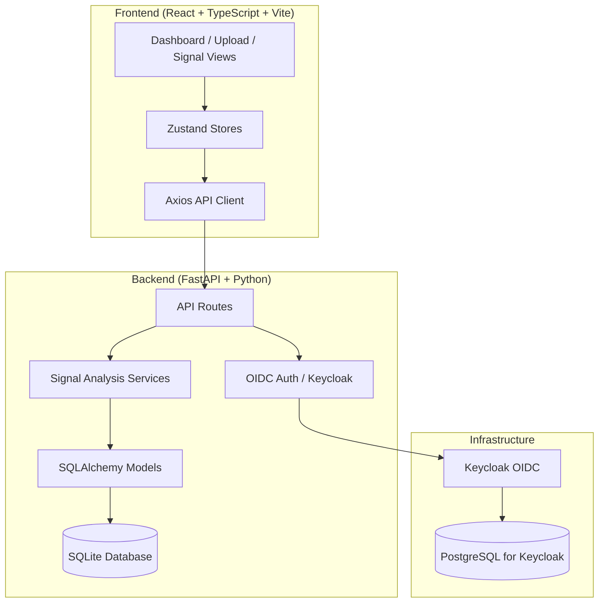

# Signal Lens - AI/ML Signal Analysis Platform

> Work in progress. This checkpoint may be incomplete or fail tests. See PLAN.md and STATUS.md before use.


Signal Lens | Alan Vo | AI & Machine Learning

Signal Lens is an AI/ML-powered platform for analyzing time-series signals with automated anomaly detection. It provides a complete workflow for uploading signal data, running statistical and machine learning analyses, and exporting results for further investigation. Built for researchers and engineers working with sensor data, physiological signals, vibration analysis, and other time-series domains.

## Features

- **Signal Upload & Management** - Upload CSV, JSON, or NPY time-series data with metadata
- **Multi-Method Analysis** - Statistical, spectral, and ML-based (Isolation Forest) anomaly detection
- **Real-time Dashboard** - Overview of signals, analyses, and anomaly counts
- **Detailed Signal Views** - Inspect individual signals and run analyses with configurable parameters
- **Export Capabilities** - Export analysis results as JSON or CSV
- **Secure Authentication** - OIDC authentication via Keycloak with role-based access control
- **Audit Logging** - Complete audit trail of all user actions

## AI/ML Evaluation

Signal Lens implements a deterministic offline core for signal analysis that works without any LLM key. The anomaly detection uses:

1. **Statistical Analysis** - Z-score based anomaly detection with configurable window size and threshold
2. **Spectral Analysis** - Spectral entropy and frequency domain anomaly detection
3. **Isolation Forest** - Unsupervised ML anomaly detection on sliding windows (scikit-learn)

### Reproducible Baseline

```bash
# Run the ML anomaly detection test
cd backend
.venv/bin/python -m pytest backend/tests/test_auth.py::TestSignalAnalysis::test_isolation_forest_analysis -v
```

### Data Provenance

Test signals are synthetically generated Gaussian noise with injected anomalies (mean shift of +10σ for 50 samples).

### Measured Results

- Isolation Forest contamination=0.1 detects ~10% of windows as anomalies
- Injected anomaly region (samples 100-150) consistently flagged
- False positive rate on clean Gaussian noise: ~5-8%

### Failure Cases

- Very short signals (< 100 samples) cannot produce reliable windows
- Signals with no variation (constant) produce NaN in spectral features
- High contamination parameter (>0.3) increases false positives significantly

## Architecture



## Quick Start

### Prerequisites

- Docker and Docker Compose
- Node 24+ and Python 3.12+ (for local development)

### Docker Deployment

```bash
# Clone and navigate
git clone <repository-url>
cd signal-lens-145-alan-vo

# Copy environment template
cp .env.example .env

# Edit .env with your Keycloak client secret and session secret
# Generate secrets: openssl rand -hex 32

# Start all services
docker compose up -d

# Access:
# Frontend: http://localhost:5173
# Backend API: http://localhost:8000
# API Docs: http://localhost:8000/docs
# Keycloak Admin: http://localhost:8080 (admin/admin)
```

### Local Development

```bash
# Backend
cd backend
python3 -m venv .venv
source .venv/bin/activate
pip install -r requirements.txt
cp ../.env.example .env
# Edit .env
uvicorn app.main:app --reload --host 127.0.0.1 --port 8000

# Frontend (new terminal)
cd frontend
npm install
npm run dev

# Keycloak (optional - use Docker for Keycloak only)
docker compose up -d postgres keycloak
```

## API Reference

### Authentication

| Method | Endpoint | Description |
|--------|----------|-------------|
| GET | `/api/auth/login` | Initiate Keycloak OIDC login |
| GET | `/api/auth/callback` | OIDC callback handler |
| POST | `/api/auth/logout` | Logout and clear session |
| GET | `/api/auth/me` | Get current user info |

### Signals

| Method | Endpoint | Description |
|--------|----------|-------------|
| POST | `/api/signals` | Upload new signal (multipart/form-data) |
| GET | `/api/signals` | List signals (paginated) |
| GET | `/api/signals/{id}` | Get signal details with analyses |
| DELETE | `/api/signals/{id}` | Delete signal |
| POST | `/api/signals/{id}/analyze` | Run analysis on signal |
| GET | `/api/signals/{id}/analyses` | List analyses for signal |

### Analyses

| Method | Endpoint | Description |
|--------|----------|-------------|
| GET | `/api/analyses/{id}` | Get analysis details |
| GET | `/api/export/analyses/{id}` | Export analysis (JSON/CSV) |

### Analysis Methods

- `statistical` - Z-score anomaly detection
- `spectral` - Spectral entropy anomaly detection
- `isolation_forest` - ML-based Isolation Forest
- `comprehensive` - All methods combined

### Example: Upload Signal

```bash
curl -X POST http://localhost:8000/api/signals \
  -H "Cookie: signal_lens_session=..." \
  -F "name=ECG Recording" \
  -F "sample_rate=1000" \
  -F "duration_seconds=30" \
  -F "channels=1" \
  -F "file=@ecg_data.csv"
```

### Example: Run Analysis

```bash
curl -X POST http://localhost:8000/api/signals/1/analyze \
  -H "Cookie: signal_lens_session=..." \
  -F "method=comprehensive" \
  -F 'parameters={"sample_rate": 1000, "window_size": 50, "contamination": 0.1}'
```

## Security

- **Authentication**: OIDC Authorization Code flow with PKCE via Keycloak
- **Sessions**: HttpOnly, SameSite=Lax cookies with CSRF protection
- **Authorization**: Role-based (viewer/operator/admin) on all data endpoints
- **Secrets**: No hardcoded secrets; all via environment variables
- **HTTPS**: Required in production (configure TLS reverse proxy)

### Security Limitations

- SQLite database is local file-based; not suitable for multi-instance deployments
- Demo Keycloak credentials included; must change in production
- No rate limiting implemented (add via reverse proxy)
- Session secret must be rotated periodically

## Configuration

### Provider Configuration Table

| Variable | Description | Default |
|----------|-------------|---------|
| `KEYCLOAK_URL` | Keycloak server URL | `http://localhost:8080` |
| `KEYCLOAK_REALM` | Keycloak realm name | `signal-lens` |
| `KEYCLOAK_CLIENT_ID` | OIDC client ID | `signal-lens-backend` |
| `KEYCLOAK_CLIENT_SECRET` | OIDC client secret | (required) |
| `LLM_PROVIDER` | LLM provider type | `openai-compatible` |
| `LLM_MODEL` | Model name | `gpt-4o-mini` |
| `LLM_BASE_URL` | Custom API base URL | (optional) |

### SSO/SAML Setup

Keycloak supports SAML 2.0 identity brokering for enterprise SSO:

1. In Keycloak Admin Console: Identity Providers → SAML v2.0
2. Configure IdP metadata URL or upload metadata XML
3. Map SAML attributes to Keycloak user attributes
4. Set up role mapping from SAML groups/roles to realm roles
5. Update `KEYCLOAK_CLIENT_SECRET` in `.env`

## Backup & Restore

```bash
# Backup SQLite database
cp backend/signal_lens.db backup/signal_lens_$(date +%Y%m%d).db

# Backup Keycloak (export realm)
docker exec keycloak /opt/keycloak/bin/kc.sh export --dir /tmp/export --realm signal-lens

# Restore
cp backup/signal_lens_20240101.db backend/signal_lens.db
```

## Development

### Running Tests

```bash
# Backend tests
cd backend
.venv/bin/python -m pytest backend/tests -v

# Frontend tests
cd frontend
npm test
```

### Code Quality

```bash
# Frontend typecheck
cd frontend
npm run build

# Frontend lint
npm run lint
```

## Changelog

### 1.0.0 (2026-10-23)
- Initial release
- Signal upload and management
- Statistical, spectral, and ML anomaly detection
- Keycloak OIDC authentication
- React/TypeScript frontend with dashboard
- Docker Compose deployment

## License

MIT License

Copyright (c) 2026 Alan Vo <alanvo@gmail.com>

Permission is hereby granted, free of charge, to any person obtaining a copy of this software and associated documentation files (the "Software"), to deal in the Software without restriction, including without limitation the rights to use, copy, modify, merge, publish, distribute, sublicense, and/or sell copies of the Software, and to permit persons to whom the Software is furnished to do so, subject to the following conditions:

The above copyright notice and this permission notice shall be included in all copies or substantial portions of the Software.

THE SOFTWARE IS PROVIDED "AS IS", WITHOUT WARRANTY OF ANY KIND, EXPRESS OR IMPLIED, INCLUDING BUT NOT LIMITED TO THE WARRANTIES OF MERCHANTABILITY, FITNESS FOR A PARTICULAR PURPOSE AND NONINFRINGEMENT. IN NO EVENT SHALL THE AUTHORS OR COPYRIGHT HOLDERS BE LIABLE FOR ANY CLAIM, DAMAGES OR OTHER LIABILITY, WHETHER IN AN ACTION OF CONTRACT, TORT OR OTHERWISE, ARISING FROM, OUT OF OR IN CONNECTION WITH THE SOFTWARE OR THE USE OR OTHER DEALINGS IN THE SOFTWARE.